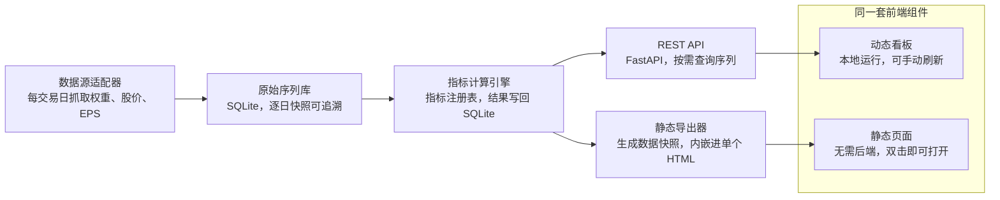

# 纳指 100 估值看板设计方案

版本 v0.1 · 2026-11-22 · 在线版本：https://claude.ai/artifact/BxmVoTwcRx4MLAEzaHHP4h

## 1. 目标与范围

看板每个交易日更新并展示纳指 100 的三个估值指标，并保证以后加指标时不改框架，只新增一个指标定义。

| 指标 | 回答的问题 |
| --- | --- |
| 前瞻 PE | 市场按未来 12 个月预期盈利给出的定价是多少倍 |
| 滚动 PE | 按过去 12 个月实际盈利算，估值是多少倍 |
| PE 历史分位 | 当前 PE 在自身 5 年、10 年历史里排在什么位置 |

本期不做：交易信号、登录与多用户、盘中实时行情（日频即可）、移动端专门适配。

## 2. 已确认的决定

三项决定已确认，实现按此进行。

| 决定 | 结论 |
| --- | --- |
| 交付形态 | 完整项目代码（本地运行）加一个静态页面 |
| 数据源 | 免费数据源，加 CSV 导入历史数据 |
| 标的范围 | 只做纳指 100，表结构预留多标的 |

静态页面是完整项目的一个导出产物：同一套前端组件，数据改为内嵌的快照文件，不依赖后端，双击即可打开，也可以放到任何静态托管上。它不是另一套实现。

## 3. 总体架构

新增指标只改计算引擎一层，两个页面自动跟上。



数据从左到右流动：适配器每个交易日抓取，原始数据落库，计算引擎按依赖顺序算出指标并写回。之后分两路：REST API 供动态看板查询，静态导出器把同样的数据打包成快照，生成静态页面。

## 4. 扩展性设计

新增指标只需要加一个指标定义文件，API 和前端都不用改。做到这一点靠两条约定：所有指标注册到同一张注册表；前端按指标自带的展示配置渲染，不写死任何指标。

| 类型 | 说明 | 本期指标 | 以后的例子 |
| --- | --- | --- | --- |
| 基础指标 | 由数据源的原始数据直接算出 | 滚动 PE、前瞻 PE | 10 年期国债收益率 |
| 派生指标 | 由其他指标的序列算出 | PE 历史分位 | 风险溢价、PEG、CAPE |

每个指标定义包含四部分：

- 元信息：ID、名称、单位、口径说明
- 依赖：需要哪些原始序列或其他指标
- 计算函数：输入依赖序列，输出一条新序列
- 展示配置：卡片类型（数值、分位条、折线）、参考线、阈值颜色

指标定义的样子（示意）：

```python
@register
class PEPercentile(Indicator):
    id = "pe_percentile"
    name = "PE 历史分位"
    unit = "%"
    depends_on = ["pe_ttm", "pe_fwd"]
    params = {"base": ["pe_ttm", "pe_fwd"], "window_years": [5, 10]}
    display = Display(kind="percentile_bar")

    def compute(self, deps, base, window_years):
        return rolling_percentile(deps[base], years=window_years)
```

新增一个指标的步骤，以风险溢价（1 ÷ 前瞻 PE − 10 年期国债收益率）为例：

1. 写一个国债收益率适配器，产出一条原始序列。
2. 写一个派生指标定义，依赖前瞻 PE 和国债收益率。
3. 给计算函数加单元测试。
4. 跑一次回填任务，补出历史值。

## 5. 指标口径

两个 PE 都按指数权重加权，成分股和权重取当日 QQQ 持仓。纳指 100 是有权重上限的修正市值加权指数，直接用“总市值 ÷ 总利润”会偏离指数的真实构成。

| 指标 | 定义 | 处理规则 |
| --- | --- | --- |
| 滚动 PE | 1 ÷ Σ（权重 × 个股盈利收益率），个股盈利收益率 = 过去 12 个月 EPS ÷ 股价 | 亏损公司计入，盈利收益率为负；缺数据的公司剔除后权重归一 |
| 前瞻 PE | 同上，EPS 换成未来 12 个月一致预期 EPS | 同上 |
| PE 历史分位 | 窗口内 PE 低于或等于当前值的交易日占比 | 窗口 5 年和 10 年；对滚动 PE 和前瞻 PE 各算一份 |

两条边界规则：

- 历史不足：实际历史不到 1 年时不显示分位；超过 1 年但不满窗口时照常显示，并标注“基于 X 年数据”。
- 数据不全：缺数据公司的权重合计超过 5% 时，当日数值标记为“不完整”。

## 6. 数据模型

五张表，全部在一个 SQLite 文件里。成分股快照单独存一张表，这样任何一天的指数 PE 都能追溯到个股数据重算。

| 表 | 用途 | 关键字段 |
| --- | --- | --- |
| `instruments` | 标的 | id、symbol、name |
| `constituent_snapshots` | 每日成分股明细 | date、instrument_id、ticker、weight、price、eps_ttm、eps_fwd、source |
| `raw_series` | 指数级原始序列，含 CSV 导入的历史 | instrument_id、series_id、date、value、source、fetched_at |
| `indicator_values` | 计算后的指标值 | indicator_id、instrument_id、date、value、params、computed_at |
| `job_runs` | 更新任务记录 | job、started_at、finished_at、status、error |

同一天同一序列有多个来源时都保留，计算时按配置的来源优先级取值。

## 7. 页面布局

单页，从上到下四个区域；动态看板和静态页面布局相同。

| 区域 | 内容 |
| --- | --- |
| 指标卡片行 | 每个指标一张卡：当前值、日变化、数据日期、来源 |
| 走势图 | 选中指标的历史折线，叠加均值和 ±1 标准差带，可切换 1、5、10 年 |
| 分位条 | 横向条形，标出当前值在 5 年、10 年区间里的位置，以及最小值、中位数、最大值 |
| 数据状态栏 | 上次更新时间、各数据源是否成功、缺失天数 |

两处差异：静态页面没有“手动刷新”按钮；它在页头显示数据快照的生成时间。

## 8. API

四个接口，前端只依赖前三个读接口。

| 接口 | 作用 |
| --- | --- |
| `GET /api/indicators` | 指标列表和各自的展示配置 |
| `GET /api/indicators/{id}/series?instrument=NDX&range=5y` | 某个指标的时间序列 |
| `GET /api/snapshot?instrument=NDX` | 所有指标的最新值 |
| `POST /api/jobs/refresh` | 手动触发一次更新 |

静态导出器调用这三个读接口背后的同一组函数，把结果写成一份快照 JSON，所以两种页面拿到的数据结构完全一致。

## 9. 技术栈与项目结构

后端 Python，前端 TypeScript，单机部署，一条命令启动。

| 层 | 选型 | 理由 |
| --- | --- | --- |
| 后端 | Python + FastAPI | 数据处理生态好 |
| 计算 | pandas | 分位和滚动窗口有现成实现 |
| 存储 | SQLite | 单机够用，以后换 PostgreSQL 成本低 |
| 调度 | APScheduler | 进程内调度，不引入额外组件 |
| 前端 | React + TypeScript + ECharts | 金融图表支持好 |
| 静态页面 | 前端构建为单个 HTML，快照数据内嵌 | 不依赖后端，可离线打开 |
| 测试 | pytest | 指标计算用固定样本做回归 |
| 部署 | Docker Compose | 一条命令启动 |

目录结构：

```text
valuation-dashboard/
├── backend/
│   ├── app/
│   │   ├── sources/        # 数据源适配器，一个来源一个文件
│   │   ├── indicators/     # 指标定义，一个指标一个文件
│   │   ├── engine.py       # 依赖解析与计算
│   │   ├── store.py        # SQLite 读写
│   │   ├── api.py          # FastAPI 路由
│   │   ├── jobs.py         # 定时更新、回填、CSV 导入
│   │   └── export.py       # 导出静态页面
│   └── tests/
├── frontend/
│   └── src/
│       ├── widgets/        # 卡片、折线、分位条
│       └── data/           # 两种数据提供方：API、内嵌快照
├── data/seed/              # 历史数据 CSV
└── docker-compose.yml
```

## 10. 主要风险：历史数据

当前值可以用免费数据算出来，但两个 PE 的长历史很可能拿不到免费的，这直接限制分位指标。下表的可得性判断还没有实测，要在实现第一步验证。

| 数据 | 免费可得性（待验证） | 应对 |
| --- | --- | --- |
| 成分股权重 | QQQ 持仓每日公开 | 直接抓取 |
| 股价、当前 EPS、预期 EPS | yfinance 可取，但它是非官方接口，可能失效或限流 | 适配器可替换；失败时保留上次成功值并在状态栏提示 |
| 滚动 PE 的 10 年历史 | 免费源通常只给最近一年多的季度盈利 | CSV 导入历史序列 |
| 前瞻 PE 的历史 | 基本没有免费来源 | CSV 导入；同时从上线当天起每日自行积累 |

CSV 导入的序列和自己计算的序列口径可能不同。导入时记录来源，走势图用不同线型区分，分位卡片注明历史数据的来源。

## 11. 实施步骤与验收

按下面的顺序做。第 1 步的结果可能让第 5 节的口径或第 10 节的应对需要调整。

1. 验证数据源：确认能取到成分股权重、股价、过去 12 个月 EPS、预期 EPS。
2. 后端核心：存储、适配器、指标引擎、三个指标及单元测试。
3. 定时任务和 CSV 导入。
4. API。
5. 前端看板。
6. 静态导出。
7. Docker Compose 和 README。

验收标准：

- 当日滚动 PE 与 GuruFocus、WorldPERatio 的公布值偏差在 10% 以内。口径不同，只做量级核对。
- 新增一个示例指标（盈利收益率 = 1 ÷ PE）只需新增一个文件，API 和前端零改动。
- 静态页面断网可以打开，数值与动态看板一致。
- 数据源失败时页面显示上次成功的日期和数值，不显示空值或 0。
